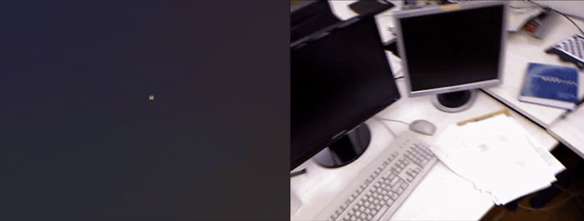

<p align="center">

  <h1 align="center">CalfVO: Monocular Visual Odometry without Calibration or Test-time Optimization</h1>
  <p align="center">
    <a href="https://vladimiryugay.github.io/"><strong>Vladimir Yugay</strong></a><sup>*</sup>
    ·
    <a href="https://scholar.google.nl/citations?user=welhhBIAAAAJ&hl=nl"><strong>Duy-Kien Nguyen</strong></a><sup>*</sup>
    ·
    <a href="https://staff.fnwi.uva.nl/th.gevers/"><strong>Theo Gevers</strong></a>
    ·
    <a href="https://www.linkedin.com/in/cgmsnoek/"><strong>Cees G. M. Snoek</strong></a>
    ·
    <a href="https://oswaldm.github.io/"><strong>Martin R. Oswald</strong></a>
  </p>
  <p align="center"><sup>*</sup>Equal contribution &nbsp;·&nbsp; University of Amsterdam</p>
  <h3 align="center"><a href="https://vladimiryugay.github.io/calfvo">Project Page</a> | <a href="https://arxiv.org/abs/2510.03348">arXiv</a></h3>
  <div align="center"></div>
</p>

<p align="center">
  <a href="https://vladimiryugay.github.io/calfvo">
    
  </a>
</p>

## ⚙️ Setting Things Up

Clone the repo:

```
git clone https://github.com/VladimirYugay/CalfVO.git
```

Make sure that ```nvcc --version``` matches ```nvidia-smi``` version. The optional
RoPE2D CUDA kernel is compiled against it.

Run the following commands to set up the environment
```
conda create -n calfvo python=3.10
conda activate calfvo
```
Install pytorch. We trained and evaluated with the CUDA 12.1 build and have not tried
the other two:
```
# CUDA 11.8
pip install torch==2.5.1 torchvision==0.20.1 --index-url https://download.pytorch.org/whl/cu118
# CUDA 12.1  (tested)
pip install torch==2.5.1 torchvision==0.20.1 --index-url https://download.pytorch.org/whl/cu121
# CUDA 12.4
pip install torch==2.5.1 torchvision==0.20.1 --index-url https://download.pytorch.org/whl/cu124
```
Install FFmpeg, capped below version 8 (torchcodec only supports FFmpeg 4-7):
```
conda install -c conda-forge "ffmpeg<8"
```
Skipping this fails at the first `import torchcodec` with `Could not load
libtorchcodec`.

Install other dependencies:
```
pip install -r requirements.txt
```

Fetch CroCo and DUSt3R. This clones ```naver/croco``` at ```743ee71a``` and
```naver/dust3r``` at ```c9e9336a```, then patches one file in croco so it can be
imported as a package. ```--with-curope``` also builds the CUDA RoPE2D kernel. Without
it CroCo uses a pure PyTorch RoPE that gives the same answer and runs slower.
```
bash scripts/setup_dependencies.sh --with-curope
```

We tested our code on A100-SXM4-40GB GPUs with Ubuntu 22.

## 🔨 Running CalfVO

  <details>
  <summary><b>Getting the Data</b></summary>
  Every dataset is stored the same way, one directory per sequence holding an
  all-intra <code>video.mp4</code>, a <code>poses.npz</code> of camera-to-world
  matrices, and an <code>intrinsics.npz</code>. Frame <i>i</i> of the video and pose
  <i>i</i> are the same instant.
  <br>
  <br>

  Every script below lives in <code>scripts/data/</code>.

  | Corpus | Role | Getting the raw data | Preparing it |
  |---|---|---|---|
  | TartanAir v2 | train (45) | `process_tartanv2.py` fetches it from HuggingFace | `process_tartanv2.py` |
  | TartanAir v1 | test | `process_tartanv1.py` fetches it from HuggingFace | `process_tartanv1.py` |
  | ScanNet | train (40) + test | `download_scannet.py`, after accepting the ScanNet terms of use | `process_scannet.py` |
  | TUM RGB-D | test | `download_tum.sh` | `process_tum.py` |
  | EuRoC MAV | test | `download_euroc.sh` | `process_euroc.py` |
  | KITTI odometry | train 00–08 (20) + test 09–10 | **manual**, the odometry grayscale/colour set from [cvlibs.net](https://www.cvlibs.net/datasets/kitti/eval_odometry.php) | `process_kitti.py` |
  | Virtual KITTI 2 | train (20) | **manual**, the `vkitti_2.0.3_rgb` and `vkitti_2.0.3_textgt` tarballs from [Naver Labs](https://europe.naverlabs.com/research/computer-vision/proxy-virtual-worlds-vkitti-2/) | `process_vkitti.py` |

  <b>The two TartanAir scripts need no separate download.</b> They pull one zip at a
  time from HuggingFace, convert it, and delete it before moving on, so you need room
  for one archive rather than the whole corpus.
  </details>

  <details>
  <summary><b>Training</b></summary>

  ```
  torchrun --nnodes=1 --nproc_per_node=16 train.py \
      --config_path configs/calfvo_croco.yaml
  ```

  The schedule and the data mixture live in the config, and the paper explains the
  choices. Runs log to <code>wandb</code>. To keep them on disk instead, set
  <code>logging.offline: True</code> in the config or start the run with
  <code>WANDB_MODE=offline</code>.
  </details>

  <details>
  <summary><b>Checkpoints</b></summary>
  Two trained models live on
  <a href="https://huggingface.co/voviktyl/CalfVO">HuggingFace</a>, one per backbone.
  <br>
  <br>

  | Config | Checkpoint | Encoder | Licence |
  |---|---|---|---|
  | `configs/calfvo_croco.yaml` | `calfvo_croco.pth` | CroCo v2, as distributed with DUSt3R | CC BY-NC-SA 4.0 |
  | `configs/calfvo_dinov2.yaml` | `calfvo_dinov2.pth` | DINOv2 ViT-L/14 | Apache-2.0 |

  The paper reports <code>calfvo_croco.pth</code>. Its encoder weights are
  non-commercial, so use <code>calfvo_dinov2.pth</code> if that matters to you. It is
  the weaker of the two on most metrics.
  </details>

  <details>
  <summary><b>Evaluation</b></summary>

  Scoring our released model takes nothing but the config. The checkpoint for its
  backbone is fetched from HuggingFace and cached, so there is no download step.

  ```
  torchrun --nnodes=1 --nproc_per_node=16 test.py \
      --config_path configs/calfvo_croco.yaml
  ```

  This scores every sequence in <code>test_datasets</code> and writes per-scene
  metrics and trajectories, plus one summary per corpus.

  Give <code>--checkpoint_path</code> a run directory to score a model you trained
  yourself, and it reads that run's own config:

  ```
  torchrun --nnodes=1 --nproc_per_node=16 test.py \
      --checkpoint_path /path/to/output/calfvo/calfvo_croco
  ```
  </details>

  <details>
  <summary><b>Demo</b></summary>
  Point it at any video and it writes the trajectory. Nothing needs preparing, and it
  does not need ground truth:

  ```
  python scripts/run_vo_demo.py \
      --config configs/calfvo_croco.yaml \
      --video /path/to/clip.mp4 \
      --output_dir output/demo/vo
  ```

  The checkpoint comes from HuggingFace here too, the released one for the config's
  backbone. Pass <code>--checkpoint</code> to run a model of your own instead.

  It writes the trajectory where the visualiser can read it, and prints the command
  to view it:

  ```
  python scripts/visualize_trajectory.py \
      --trajectory_dir output/demo/vo \
      --video /path/to/clip.mp4 --output_file out/clip.rrd
  ```

  That needs <code>pip install rerun-sdk</code>, which the training environment does
  not include.
  </details>

  <details>
  <summary><b>Training on Your Own Data</b></summary>
  CalfVO is a neural network, not a foundation model and not an optimisation
  pipeline. It predicts what it was trained on, so on a camera or a motion unlike
  the corpora above it is better to train on your own recordings.
  <br>
  <br>

  Store your sequences the way the scripts in <code>scripts/data/</code> store
  theirs, one directory per sequence with a <code>video.mp4</code> and a
  <code>poses.npz</code>, then add an entry for it under
  <code>training_datasets</code>.

  <ul>
  <li>Frames go into a video to limit the number of files.</li>
  <li>They are stored as 288 px squares, which is the crop training reads anyway,
  so less is decoded per frame.</li>
  <li>Every frame is a keyframe. Training reads windows from random places in a
  sequence, and in an ordinary video each seek decodes forward from the last
  keyframe.</li>
  </ul>

  Set <code>pose_stats</code> to match your data. Translations are divided by these
  before the loss sees them. The shipped numbers do not come from any one corpus,
  they were picked to work across all of them. If your motion has a different scale,
  take the mean and the standard deviation of your own frame to frame translations
  and use those.
  <br>
  <br>

  Results may differ slightly between runs because training samples data at random.
  </details>

## 📌 Citation

If you find our paper and code useful, please cite us:

```bib
@misc{yugay2026calfvo,
      title={Monocular Visual Odometry without Calibration or Test-time Optimization},
      author={Vladimir Yugay and Duy-Kien Nguyen and Theo Gevers and Cees G. M. Snoek and Martin R. Oswald},
      year={2026},
      eprint={2510.03348},
      archivePrefix={arXiv},
      primaryClass={cs.CV},
      url={https://arxiv.org/abs/2510.03348},
}
```
